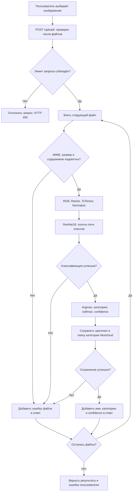

# Модель в процессе PhotoDistribution

## Какую задачу решает модель

Определяет категорию изображения: животные, город, документы, природа или люди,
чтобы автоматизировать сортировку файлов по папкам.

## Почему используется ML

Модель определяет категорию по визуальному содержимому, которое нельзя
надёжно установить по имени или расширению файла.

## Входные данные

Изображение, преобразованное в RGB, уменьшенное до 224 × 224 пикселей
и нормализованное перед передачей в ResNet18.

## Как используется результат

Предсказанная категория задаёт папку Nextcloud для сохранения исходного файла.
Пользователь получает название категории и результат загрузки.
