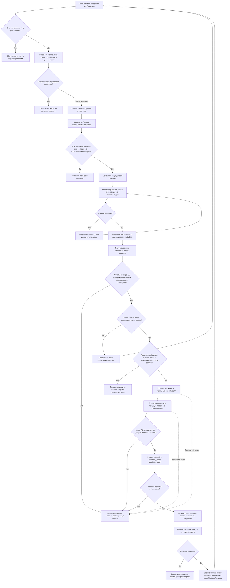

# Процесс повторного обучения модели

| Этап | Действие и результат |
|---|---|
| Сбор | При согласии пользователя сохраняются копия файла, хеш, прогноз, confidence, время и SHA-256 модели в SQLite |
| Разметка | Пользователь явно подтверждает или исправляет категорию; отсутствие ответа не считается правильной меткой |
| Подготовка | Сборщик создаёт новый ImageFolder-кандидат и manifest, исключая точные дубликаты, конфликты и совпадения с указанными наборами |
| Проверка данных | Сопровождающий проверяет метки, похожие серии и происхождение; разделяет train и holdout и готовит metadata |
| Триггер | Проверенные отчёты одной версии модели сравниваются по macro-F1 и recall классов |
| Обучение | При деградации сценарий обучает кандидата и сохраняет отдельный checkpoint |
| Проверка качества | Кандидат и действующая модель сравниваются на одинаковом holdout; код выдаёт рекомендацию |
| Публикация | Человек утверждает версию, сохраняет предыдущие веса, устанавливает кандидата и проверяет сервис; при сбое возвращает прежнюю версию |

## Граница автоматизации

Код сохраняет примеры только с согласия пользователя, принимает явные метки
через `/feedback/{sample_id}` и выгружает кандидатов командой
`scripts/export_feedback.py`. Прогноз модели и отсутствие исправления не считаются
правильной меткой. Выгрузка имеет статусы `unreviewed` и `unverified`.

Человек проверяет разметку и похожие кадры, готовит отдельные train и holdout,
запускает оценку и сценарий переобучения. Сценарий автоматически проверяет отчёты,
при `--execute` обучает кандидата и рекомендует публикацию. Утверждение, деплой
и откат выполняются вручную. Планировщик пока не установлен.

Исправление категории сохраняет обучающую метку, но не перемещает файл в Nextcloud.
Пользовательская авторизация отсутствует: личность автора метки не подтверждена.
Для мониторинга нужна случайная выборка загрузок, а не только исправленные ошибки.

Команды оценки и обучения: [RETRAINING.md](RETRAINING.md).
