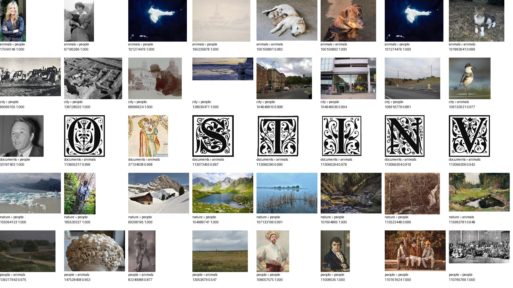

# Анализ модели на внешних кандидатах

Дата: 2 ноября 2026 года.

## Основной результат

На **456 изображениях** совпали с метками папок **172** предсказания;
**284** не совпали. Accuracy относительно этих меток — **37.72%**,
macro-F1 — **0.3014**, weighted-F1 — **0.2816**.

**Это диагностическая оценка по непроверенным поисковым меткам, а не независимый
тест точности.** Неверные метки и нерелевантные результаты поиска влияют на метрики.
При этом визуальный просмотр подтвердил отдельные явные ошибки модели.

## Данные и метод

- Все 456 файлов `my_dataset/test_candidates`: по 100 animals, city, nature, people и 56 documents.
- Источник — Wikimedia Commons; ссылки, авторство и лицензии сохранены в manifest.
- Истинной меткой для расчёта временно считается название папки. Ручная проверка всей выборки не проведена.
- Использован текущий checkpoint без переобучения, те же RGB/Resize/Normalize и inference, что в сервисе.
- CPU, четыре потока, PyTorch 2.12.0; seed 42. При лимите 100 взяты все доступные файлы каждого класса.
- Ошибок обработки: 0. Побайтовых дубликатов внутри выборки: 0; точных совпадений с локальным train не найдено по аудиту.
- Похожие изображения, серии и пересечение с исходным legacy-обучением не исключены.

## Метрики по категориям

| Категория | Precision | Recall | F1 | Support |
|---|---:|---:|---:|---:|
| animals | 0.5429 | 0.5700 | 0.5561 | 100 |
| city | 0.0000 | 0.0000 | 0.0000 | 100 |
| documents | 1.0000 | 0.3393 | 0.5067 | 56 |
| nature | 0.0000 | 0.0000 | 0.0000 | 100 |
| people | 0.2892 | 0.9600 | 0.4444 | 100 |

Для city и nature precision равен 0 по правилу `zero_division=0`: модель
вообще не предсказывала эти категории. Высокий recall people не означает
хорошее качество этого класса: precision people составляет лишь 28,9%.

## Матрица ошибок

Строки — метки папок, столбцы — предсказания.

| Метка / прогноз | animals | city | documents | nature | people |
|---|---:|---:|---:|---:|---:|
| animals | 57 | 0 | 0 | 0 | 43 |
| city | 2 | 0 | 0 | 0 | 98 |
| documents | 24 | 0 | 19 | 0 | 13 |
| nature | 18 | 0 | 0 | 0 | 82 |
| people | 4 | 0 | 0 | 0 | 96 |

## Что происходит с предсказаниями

- В people попали 332 из 456 файлов (72,8%); в animals — 105; в documents — 19.
- В city и nature не попал ни один файл. Из папки city 98 файлов отнесены к people, из nature — 82.
- Из 56 документов 24 отнесены к animals, 13 к people, 19 совпали с меткой documents.
- Средний confidence — 0.945. Среди 381 прогнозов с confidence ≥ 0,9
  229 не совпали с меткой папки; согласие на этом подмножестве — 39.9%.
- Простой порог 0,9 не устраняет уверенные ошибочные назначения. Оценка формальной калибровки требует проверенных меток.
- Базовый прогноз одного самого частого класса дал бы 21.93% совпадений. Это лишь ориентир на текущем составе папок.

## Визуальная проверка примеров

Просмотрена подборка из 40 позиций (с возможными повторами), включающая
самые уверенные несовпадения и файлы по порядку имени в каждом классе.
Это целевая проверка примеров, а не репрезентативный аудит всей разметки.



Подтверждены две разные проблемы:

1. **Ошибки поисковых меток.** В animals есть портрет человека (`17044149`),
   в city — фотография птицы (`109133021`), в people — пейзаж (`139217943`).
   Их несовпадение с папкой нельзя автоматически считать ошибкой классификатора.
   В documents также есть декоративные буквицы и портрет; в people — живопись.
2. **Ошибки модели на понятных сценах.** Озеро (`107133106`), лесной ручей
   (`107604865`), ледниковый пейзаж (`155094123`) и горное озеро (`154986747`)
   классифицированы как people. На миниатюрах видны пейзажи без явного человека
   как основного объекта. Это основание проверить качество обобщения, даже
   с учётом шума остальных меток.

Идентификаторы — page ID Wikimedia; соответствующие URL и пути находятся
в `my_dataset/test_candidates/manifest.json`. Все метки набора по-прежнему
считаются unreviewed: отдельный просмотр примеров не заменяет полный аудит.

## Сопоставление с прежней диагностикой

| Выборка | Размер | Совпадение с метками | Macro-F1 |
|---|---:|---:|---:|
| Локальный train, 200 на класс | 1 000 | 99,90% | 0,9990 |
| Внешние поисковые кандидаты | 456 | 37.72% | 0.3014 |

Разрыв большой, но напрямую приписывать его переобучению нельзя. Возможны
шум разметки, сдвиг источников и типов изображений, особенности старого обучения
или ошибки соответствия классов. Причины ещё не установлены. Высокая оценка
на локальном train не подтверждает пригодность для новых загрузок.

## Вывод для сервиса и следующие шаги

На этих кандидатах модель не обеспечивает надёжную автоматическую сортировку:
результаты сильно смещены в people, а city и nature не используются. До проверки
на согласованно размеченных данных полагаться на неё для автоматического выбора
папки без возможности ручного исправления не следует.

Приоритеты: проверить и исправить метки всего внешнего набора, отдельно учитывать
фотографии и рисунки, проверить порядок классов и историю legacy-checkpoint,
затем повторить оценку. Если проблема сохранится — переобучать на разнообразных
данных с отдельными train/validation/test. Порог для ручной проверки выбирать
на validation; текущий тест не использовать для подбора параметров.

## Воспроизведение и артефакты

```bash
poetry run python evaluate_model.py --data my_dataset/test_candidates --per-class 100 --output external_evaluation_report.json
```

Команда воспроизводит предсказания и основные метрики. Дополнительная секция
`diagnostics` в сохранённом JSON рассчитана при анализе этих предсказаний.

[Полный отчёт с предсказаниями](external_evaluation_report.json),
[аудит данных](test_candidates_audit.json), [Model Card](model_card.md).

SHA-256 оценённой модели:

`aa3c2df52bce6fdbd8b789c3323e61268fedc25d0cc7e94a5a84a146cd1cfa7c`
